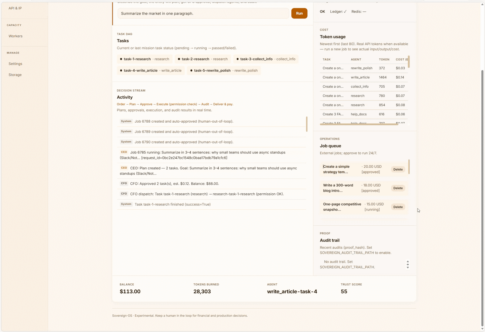
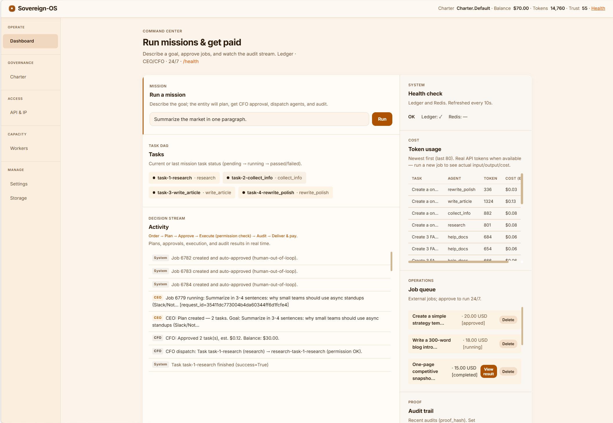
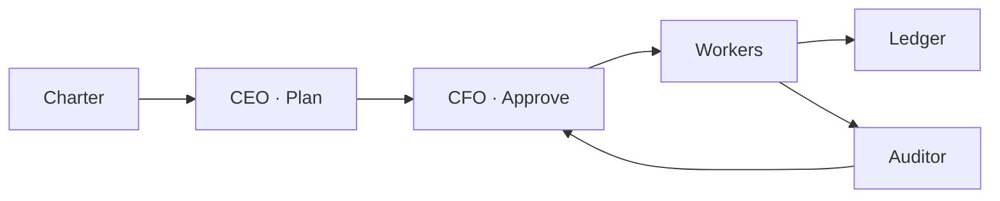
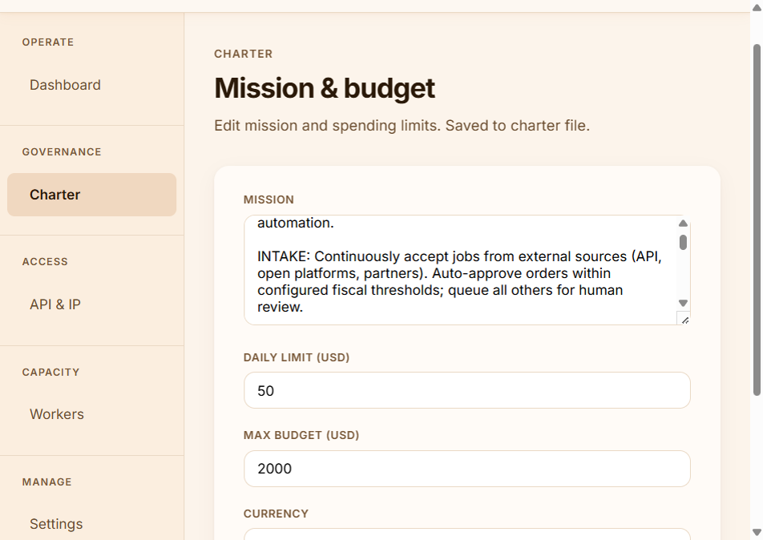
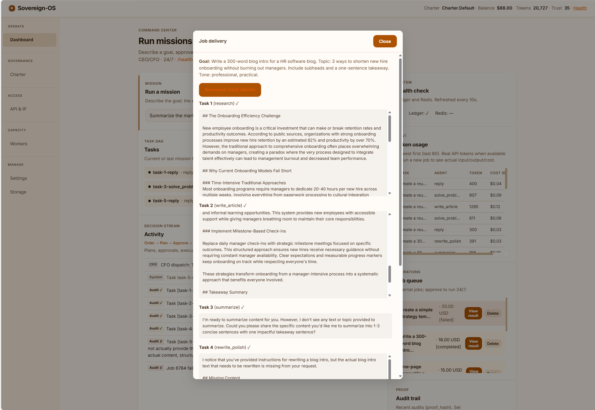
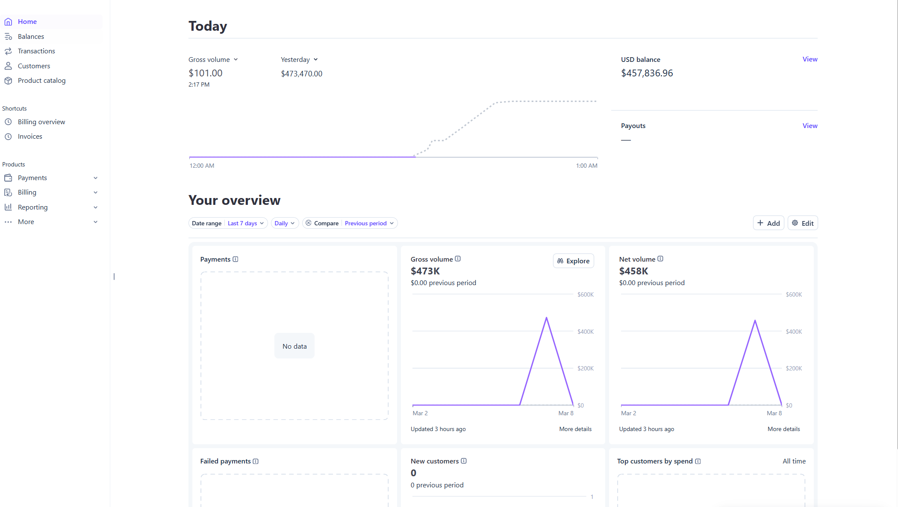
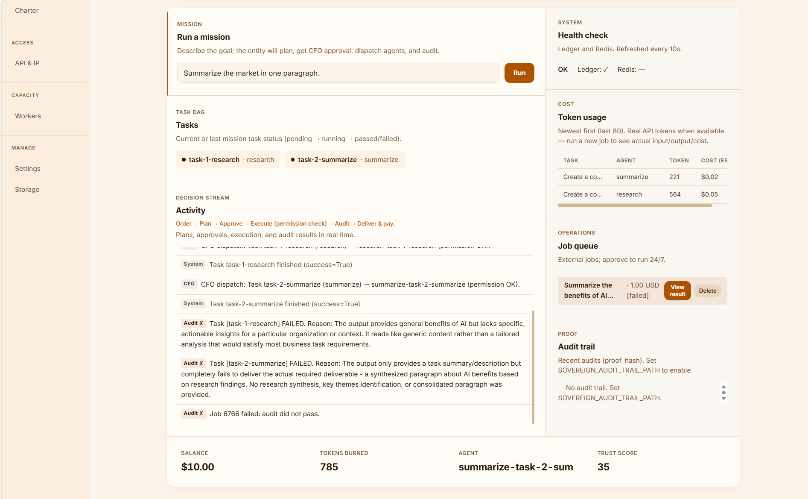
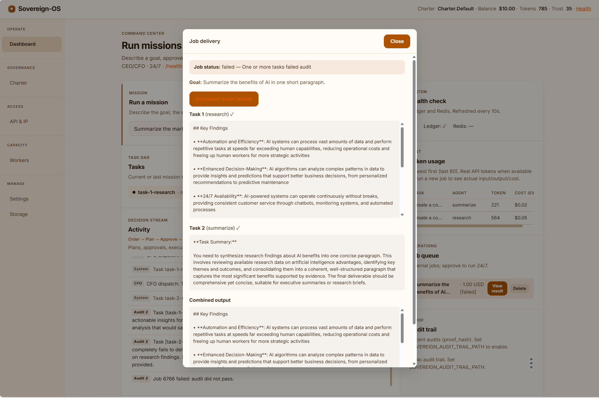

<p align="center">
  <a href="https://github.com/Justin0504/Sovereign-OS/actions"></a>
  <a href="LICENSE"></a>
  <a href="https://arxiv.org/abs/2603.14011"></a>
  <a href="https://www.python.org/downloads/"></a>
</p>

<p align="center">
  
</p>

<p align="center">
  <strong>Governance for an autonomous AI workforce — runs on your machine, on your keys.<br>
  Submit a goal: Sovereign-OS plans it, checks the budget, executes with built-in workers, and delivers a cryptographically verified result.</strong>
</p>

<p align="center">
  <em>Open source &bull; self-hosted &bull; bring your own keys &bull; no fund custody</em>
</p>

<p align="center">
  <a href="#quick-start">Quick Start</a> &bull;
  <a href="#architecture">Architecture</a> &bull;
  <a href="#features">Features</a> &bull;
  <a href="#deployment">Deployment</a> &bull;
  <a href="#configuration">Configuration</a> &bull;
  <a href="#custom-workers">Custom Workers</a> &bull;
  <a href="#docs">Docs</a>
</p>

<p align="center">
  
</p>

---

## Overview

Sovereign-OS is not another chatbot wrapper or agent framework. It is an **operating system for autonomous AI work**: a governance layer that enforces budget, quality, and permissions before any token is spent or any task is executed.

The core contract is simple. One YAML file — the **Charter** — declares the agent's mission, spending limits, KPIs, and allowed capabilities. Everything else — planning, approval, execution, auditing, payment — flows from that file.

```
Charter → CEO (plan) → CFO (approve budget) → Workers (execute) → Auditor (verify) → Ledger (record)
```

The Ledger is append-only. The Auditor is cryptographically bound. Neither can be overridden at runtime.

---

## Why Sovereign-OS?

|                  | Typical agent frameworks                   | Sovereign-OS                                                                       |
|------------------|--------------------------------------------|------------------------------------------------------------------------------------|
| **Cost control** | API key = burn until empty.                | Every cent and token is tracked. The budget is checked before every task. Daily caps + circuit breaker enforced. |
| **Quality**      | Hope the output is correct.                | Every task verified against Charter KPIs. Fail audit → TrustScore drops. Proof hash on every report. |
| **Permissions**  | All-or-nothing.                            | Agents start sandboxed. They earn capabilities (`SPEND_USD`, `CALL_API`, `WRITE_FILES`) via TrustScore. |
| **Monetization** | None.                                      | Built-in job queue, Stripe integration, ingest from any source, webhook on delivery. |

---

## What we measured

Claims about governance are cheap. Each of these is a harness in this repo that you can
run, and each reports a number we did not like.

```bash
python -m sovereign_os.bench.governance_eval    # fiscal · permission · audit integrity
python -m sovereign_os.bench.calibration_run    # does it know what its own work costs?
python -m sovereign_os.bench.ruin               # does being wrong about that bankrupt it?
```

**The cost estimator is tilted, not noisy.** Across 49 governed runs on a live model, small
tasks are over-estimated ~1.8× and large ones under-estimated ~1.7× — monotonically and
reproducibly, because the difficulty signal reads the goal string's length, which varies
1.21× while realized cost varies 12.8×. 95% of the error is systematic rather than planner
noise. The per-category multiplier the system ships **cannot** fix this: one factor shifts
the line without changing its slope. Estimating from the task graph the planner already
produces — computed before execution, then discarded — takes predictions within 2× of
realized cost from 62% to 94%. See [docs/CALIBRATION_FINDINGS.md](docs/CALIBRATION_FINDINGS.md).

**That tilt bankrupts an expected-value agent.** The error has a *direction*: large jobs look
cheap, so their EV is inflated and they get accepted, which means the agent systematically
takes the jobs it has underpriced. Simulated over a 4,000-task horizon at thin margins, the
EV rule reaches zero in 10.8% of lifetimes. The control that makes this a finding rather
than a statement about our assumptions: an ablation with the same noise and **no direction**
ruins 0% at every horizon tested. Sizing on an upper quantile of the measured error removes
the ruin *and* ends richer (median 127,543 vs 122,764) while accepting a third fewer jobs —
there is no safety-versus-growth trade here, the EV rule is simply buying losers.

**Where a claim is narrower than it sounds.** The audit `proof_hash` covers the verdict —
seven fields — and *not* `agent_id`. A report re-attributed to a different agent still
verifies: 120/120 in-scope tampering caught, **0/120** out-of-scope. We report this rather
than the word "tamper-evident" on its own.

Fiscal enforcement is 30/30 violations refused and audit integrity 1,200/1,200 verifying
with zero collisions. The permission figure (200/200) measures self-consistency with the
threshold policy, which is a weaker question than a hand-labelled oracle would answer — so
it is not comparable to the 94% an earlier version of the paper reported.

---

## Quick Start

Self-hosted, everything runs on your machine on your keys. There is also a hosted
control plane if you want to try it without installing anything — it is the same
governance core, multi-tenant, and it still never holds your keys or your funds.

**Hosted — nothing to install:**

```bash
# create a workspace (or use the console at the URL below)
curl -sX POST https://sovereign-saas-production.up.railway.app/saas/tenants \
  -H 'Content-Type: application/json' -d '{"name":"Acme","plan":"free"}'
# → {"tenant": {...}, "api_key": "sk_ten_…"}   ← returned ONCE, never again

curl -sX POST https://sovereign-saas-production.up.railway.app/saas/tenants/me/missions \
  -H "X-Tenant-Key: sk_ten_…" -H 'Content-Type: application/json' \
  -d '{"goal":"Summarize the current AI agent landscape."}'
```

Console: **https://sovereign-saas-production.up.railway.app** · API: [docs/SAAS.md](docs/SAAS.md)

You supply your own Anthropic/OpenAI key per workspace; it is encrypted at rest (AES-GCM)
and masked in every API response. Tenant API keys are stored hashed, so they are not
recoverable — losing one means rotating it, by design. No funds are ever custodied.

**Docker — the whole workspace:**

```bash
git clone https://github.com/Justin0504/Sovereign-OS.git && cd Sovereign-OS
export ANTHROPIC_API_KEY=sk-ant-…        # or OPENAI_API_KEY
docker compose up -d redis web           # web console on :8000
# Open http://localhost:8000
```

**CLI — run a single mission in 30 seconds:**

```bash
pip install -e .
sovereign run --charter charter.example.yaml "Summarize the current AI agent landscape."
```

Output: task plan → budget check → execution → audit report → ledger entry.

**Web dashboard — submit missions and watch the governed run:**

```bash
pip install -e ".[llm]"
cp .env.example .env
# Edit .env: set ANTHROPIC_API_KEY or OPENAI_API_KEY (optionally STRIPE_API_KEY)
python -m sovereign_os.web.app
# Open http://localhost:8000
```

From the dashboard you can submit missions, inspect the job queue, retry jobs, and monitor token usage and the audit trail in real time. Deploying to a server or a custom domain? See **[docs/DEPLOY.md](docs/DEPLOY.md)**.

---

## Architecture

Five layers. Data flows down; accountability flows back up.

```
Charter (YAML)
    └─ Governance Engine
          ├─ CEO (Strategist)    — decomposes goals into ordered tasks; prunes to budget & re-plans on failure
          ├─ CFO (Treasury)      — approves/rejects per-task spend; daily cap, runway, margin + session circuit breaker
          └─ Worker Registry     — routes each task to the right worker by skill
                └─ Workers       — execute; emit TaskResult with token usage
                      └─ Auditor — verifies output against Charter KPIs (category-tuned rubric); signed AuditReport
                            └─ Ledger (UnifiedLedger) — append-only USD + token accounting
```

<p align="center">
  
</p>

<details>
<summary>Mermaid diagram</summary>



</details>

**Key design decisions:**

<table><tr><td valign="top" width="55%">

- The Charter is the single source of truth. Changing runtime behavior means changing the Charter, not the code.
- The Ledger is append-only JSONL. No delete, no update. Every entry carries a sequence number.
- TrustScore gates capability grants. A new agent cannot spend USD or write files until it earns them through passing audits. High-risk capabilities are further scoped by **just-in-time leases** — granted per task, auto-expiring, revoked when the task ends (zero standing privilege).
- Workers are pluggable. The 16 built-in workers cover common content and code tasks. You can add your own in a single Python file.

</td><td valign="top" width="45%">

</td></tr></table>

---

## Marketplace oversight & delivery categories

Beyond running its own missions, Sovereign-OS acts as a **governance layer over
the agent-task economy — in both directions**, applying the same two gates
(budget + delivery quality) wherever work flows.

```
INBOUND   human/agent posts ─▶ ingest (TaskBounty · StacksTasker · BotBounty · ClawTasks · APB/x402)
          ─▶ [CFO budget] ─▶ governed workers ─▶ [Auditor quality] ─▶ submit

OUTBOUND  Sovereign-OS posts ─▶ [CFO budget gate] ─▶ fund escrow (RentAHuman)
          ─▶ worker delivers ─▶ [Auditor quality gate] ─▶ release | dispute
```

- **Inbound sources** (`ingest_bridge/`) pull open tasks from real marketplaces
  (live-validated APIs); Sovereign-OS governs its own agents doing the work. Includes
  an **APB (Agent Payment Bounty) source** that discovers x402-native bounties from
  publishers' `/.well-known/bounties.json` — the standard the x402 Foundation rail is
  built on (see [docs/AUTONOMY.md](docs/AUTONOMY.md)).
- **Outbound oversight** (`oversight/`) posts tasks for external workers: the CFO
  approves the spend and reserves escrow *before* funding, and the Auditor must
  pass the deliverable *before* payment is released (else it's disputed/refunded).
  All money-moving calls are dry-run until explicitly set live; run
  `python -m sovereign_os.oversight.rentahuman_preflight` for a go-live check.

A **task-category backbone** (`agents/categories.py`) ties delivery together:
each category (coding, data, design, email, research, writing, automation) maps
to a top-tier worker, a **risk-scaled budget ceiling** (`CategoryBudgetPolicy`),
a **permission tier earned per category** (per-category TrustScore), and the
**connectors** it needs (`connectors/`, MCP / built-in / HTTP, with readiness).
Inspect it with `sovereign categories` and `sovereign connectors`.

See [docs/OVERSIGHT.md](docs/OVERSIGHT.md), [docs/CATEGORIES.md](docs/CATEGORIES.md),
[docs/CONNECTORS.md](docs/CONNECTORS.md), [docs/CLAWTASKS.md](docs/CLAWTASKS.md),
[docs/COST.md](docs/COST.md), and [docs/X402.md](docs/X402.md).

### Capability map

```
 INBOUND platforms                     GOVERNANCE                         AGENTIC WORKERS (by category)
 TaskBounty · StacksTasker  ──ingest──▶ ┌───────────────┐  ──route──▶  coding   → read·write·run_tests·submit_PR
 BotBounty · ClawTasks                  │ CFO budget gate│              research → web_fetch
                                        │  (per-category │              data     → web_fetch
 OUTBOUND (agent hires)                 │   ceilings)    │              design   → read_figma · generate_image
 RentAHuman escrow  ◀──post/fund──────  │ Auditor quality│              writing  → draft → self-critique → revise
   release | dispute  ◀──gate───────────│  (rubric)      │              ─────────────────────────────────────
                                        └───────────────┘              tools dispatched via connectors/, code
 Ledger (append-only, thread-safe) · per-model/category cost · TrustScore earned per category · Docker sandbox
```

Every task is **categorized** → routed to a **top-tier worker** → budget-gated by a
**per-category ceiling** → executed with **real tools** (web/repo/Figma/image, in a
**Docker sandbox** for untrusted code) → **quality-gated** before delivery or payout.
All money/exec is **dry-run by default**.

**Try it (no keys, no funds):**

```bash
python examples/coding_bounty_demo.py   # bug-fix: route → budget → read·write·test·PR → audit
python examples/oversight_demo.py       # outbound: budget gate + quality gate (release vs dispute)
python examples/category_demo.py        # category → worker · budget · permission · connectors
python examples/oversight_e2e.py        # full readiness check (inbound + outbound + preflights)
sovereign categories                    # the delivery-category table
sovereign connectors                    # connector readiness + required MCP servers
```

---

## Features

**Governance**
- Charter-driven: mission, competencies, KPIs, fiscal boundaries — all in one YAML.
- CEO (Strategist) decomposes natural-language goals into executable task plans with dependencies. Reactive: `prune_to_budget` sheds lowest-value tasks to fit a budget without breaking the dependency DAG; `corrective_task` builds a high-priority retry carrying the audit's failure reason and fix.
- **Profitability-first task selection** — before spending any compute, an ingest screen (`governance/economics.py`) estimates a task's fully-loaded cost (LLM by category × complexity + settlement fee + gas) and skips anything that can't clear the margin floor. Stops the classic autonomous-agent failure mode where fees/gas turn shipped work into a net loss. Opt in with `SOVEREIGN_PROFIT_SCREEN=true`; tune with `SOVEREIGN_{SETTLEMENT_FEE_RATIO,GAS_COST_CENTS,MIN_MARGIN_RATIO}`.
- **Reactive self-repair** — a task that fails audit is automatically re-run with the Auditor's reason + fix folded into its brief (`SOVEREIGN_MAX_REPAIR_ATTEMPTS=N`), recovering quality with no human in the loop. Only a fully-passing mission reaches delivery/settlement — a failed audit never gets submitted to a platform or charged.
- CFO (Treasury) enforces `max_task_cost_usd`, `daily_budget_usd`, `runway_days`, and `min_job_margin_ratio` *before* any task runs. A runtime **SpendCircuitBreaker** adds fast-fail *during* a session — it halts the loop when cumulative spend hits a session ceiling, audits fail past a streak limit, or ROI collapses (the guard that stops runaway agent loops the pre-flight gates miss). Configure via `SOVEREIGN_SESSION_CEILING_CENTS`, `SOVEREIGN_MAX_CONSECUTIVE_FAILURES`, `SOVEREIGN_ROI_FLOOR` (all default off); watch it live on the dashboard **Guardrails** tab (session spend vs. ceiling, failure streak, ROI, one-click reset).
- **Permissions** — TrustScore-gated capabilities (`READ_FILES`, `WRITE_FILES`, `EXECUTE_SHELL`, `SPEND_USD`, `CALL_EXTERNAL_API`), earned per category, with graduated autonomous-spend ceilings. High-risk grants use **just-in-time leases**: scoped to one task, bounded by TTL and use-count, auto-revoked on completion (`grant_lease` / `use_lease` / `revoke_task_leases`). Active leases and per-agent trust are shown live on the dashboard **Guardrails** tab.
- **Governed delegation** — the moment an agent hands work to something else (a sub-agent, an MCP tool, an external coding agent, a funded escrow), every check performed on the planner was performed on the wrong thing. Authority is modelled as object capabilities that can only *narrow* as they are passed on: effective authority is the intersection of the grant and the holder's own eligibility, budget is **reserved from the parent** rather than reissued (so splitting a task across three sub-agents cannot outspend the task), revocation cascades, and a principal chain makes any leaf action attributable to the root mission. Evaluated against an explicit adversary — 14 attacks, reported per elicitation level — rather than a cooperative one. Permissive by default so the single-tenant self-host keeps working; set `SOVEREIGN_STRICT_DELEGATION=1` to turn an unauthorized handoff into a refusal (the hosted deployment sets it). See [docs/THREAT_MODEL.md](docs/THREAT_MODEL.md).
- **Two dashboards, same guardrails** — the web dashboard (Guardrails tab + per-task quality scorecard) and a **Textual terminal Command Center** (`python -m sovereign_os.ui.app`) both surface the CFO circuit breaker (session spend vs. ceiling, failure streak, ROI; press `b` to reset), active JIT leases, and the category-rubric breakdown streamed live under each audit verdict.
- **Prometheus metrics** — all three guardrails export on `/metrics` for Grafana: breaker session spend/ceiling/ROI/trips, active JIT leases, per-agent trust, and per-category audit-quality histograms (overall + per rubric criterion). See [docs/METRICS.md](docs/METRICS.md) for the metric list and PromQL starter panels.

**Execution**
- 20 built-in workers: `summarize`, `research`, `reply`, `write_article`, `write_email`, `write_post`, `meeting_minutes`, `translate`, `rewrite_polish`, `collect_info`, `extract_structured`, `spec_writer`, `solve_problem`, `assistant_chat`, `code_assistant`, `code_review`, `test_gen`, `data_analysis`, `design_brief`, `help_docs`.
- **Verification-driven coding** — the coding worker runs a harness-enforced loop (`run_with_verified_tools`): it won't accept "done" until the **test suite actually passes**. A premature answer bounces back with the failing test output and the model must fix and re-verify — code that can't reach green is marked `tests_verified=false` / `success=false`, so broken work never ships to a paid bounty. Gates only when execution is enabled (`SOVEREIGN_CODE_EXEC_ENABLED`); otherwise it's a no-op skip.
- Multi-model: Strategist and workers can use different backends (e.g. GPT-4o for planning, Claude for execution).
- **Pluggable agent backends** — for complex delivery a worker can delegate a whole task to a purpose-built coding agent (**Claude Code, OpenAI Codex, Gemini CLI, Aider**, or any headless CLI via a command template) instead of a single chat call. One stable `AgentBackend` seam; new agents plug in by config (`SOVEREIGN_AGENT_BACKEND` / `SOVEREIGN_BACKEND_<CATEGORY>`), dry-run until `SOVEREIGN_AGENT_BACKEND_ENABLED=true`.
- **MCP connectors in every worker** — register MCP servers via `SOVEREIGN_MCP_SERVERS` and their tools appear inline in every worker's tool-use loop, next to built-ins like `web_fetch`. Any MCP-provided connector (DBs, search, SaaS, another agent over MCP) becomes callable mid-task with no code change — the universal connector layer both Claude Agent SDK and Codex speak. See [docs/BACKENDS.md](docs/BACKENDS.md).
- Dynamic worker loading: drop a Python file into `sovereign_os/agents/user_workers/` — no registration boilerplate.

**Auditing**
- Every task output is verified against Charter KPIs by the ReviewEngine.
- **Category-tuned analytic rubric**: high-value deliverables are scored criterion-by-criterion on a rubric matched to the work type — coding gets correctness/completeness/robustness/relevance, writing gets clarity/voice, etc. — always ending in a `safety` criterion. Criterion order is deterministically shuffled per task to blunt LLM-judge positional bias.
- Value-aware bar: higher-paid jobs must clear a stricter passing score; cheap tasks can skip the (relatively expensive) LLM judge.
- AuditReport carries `score`, `passed`, `reason`, `suggested_fix`, `sub_scores`, and `proof_hash` (SHA-256 of inputs + output). Each job's delivery view renders a **quality scorecard** — the per-criterion rubric breakdown (bars per criterion, category label, overall score) so you can see *why* a deliverable passed or failed, not just the verdict.
- Append-only audit trail (JSONL). Integrity verifiable offline.

**Monetization & job queue**
- SQLite-backed job queue (Redis optional for multi-instance).
- Stripe integration: set `STRIPE_API_KEY` and each completed job triggers a real charge; transactions appear in your Stripe Dashboard.
- Auto-approval mode or manual review per job.
- Ingest from any HTTP endpoint, Reddit (PRAW), Shopify, WooCommerce, or custom scrapers via the ingest bridge.
- Webhook delivery: `POST` job result to any URL on completion.

<p align="center">
  &nbsp;
  
</p>
<p align="center"><sub>Left: job result delivered in the dashboard. Right: charges recorded directly in Stripe Dashboard.</sub></p>

**Observability**
- OpenTelemetry tracing.
- Prometheus metrics at `GET /metrics`: job counters, queue depth, task duration histograms.
- `GET /health` returns config warnings (missing API keys, payment mode).
- Structured JSON logs with correlation IDs.

**Security**
- API key authentication (constant-time comparison).
- Optional IP allowlist and per-IP rate limiting.
- Job input validation (Pydantic v2).
- No secrets in code; everything via environment variables.

<p align="center">
  &nbsp;
  
</p>
<p align="center"><sub>TrustScore-gated permission system — agents earn capabilities through passing audits.</sub></p>

---

## Project Layout

```
sovereign_os/
├── models/           # Charter schema (Pydantic v2)
├── ledger/           # UnifiedLedger — append-only USD + token accounting
├── governance/       # CEO (Strategist), CFO (Treasury), SpendCircuitBreaker, GovernanceEngine
├── agents/           # Workers, WorkerRegistry, SovereignAuth (+ JIT leases), categories, user_workers/
├── auditor/          # ReviewEngine, category rubric, AuditReport (proof_hash), KPIValidator
├── jobs/             # JobStore (SQLite), RedisJobStore
├── ingest/           # HTTP poller → job queue
├── ingest_bridge/    # Reddit, scrapers, Shopify/WooCommerce → jobs
├── oversight/        # Outbound task posting + escrow (RentAHuman, StacksTasker)
├── delivery/         # Deliver-back adapters (TaskBounty, StacksTasker, ClawTasks, Reddit, APB/x402)
├── connectors/       # web_fetch, code_workspace, figma, image_gen, submit_pr, sandbox
├── payments/         # StripePaymentService, X402PaymentService, DummyPaymentService
├── ui/               # Textual terminal Command Center (TaskTree · DecisionStream · Finance & Guardrails)
├── web/              # FastAPI app, dashboard, /api/jobs, /health, Stripe webhook
└── telemetry/        # OpenTelemetry, Prometheus
charters/             # Example Charter YAML files
examples/             # Example job payloads
tests/                # pytest
docs/                 # Full documentation
```

---

## Deployment

### Local (bare metal)

```bash
git clone https://github.com/Justin0504/Sovereign-OS.git
cd Sovereign-OS
pip install -e ".[llm]"
cp .env.example .env
# Edit .env with your API keys
python -m sovereign_os.web.app
```

Listens on `http://0.0.0.0:8000` by default. Set `SOVEREIGN_HOST` and `SOVEREIGN_PORT` to change.

### Docker Compose (recommended for production)

```bash
cp .env.example .env
# Edit .env
docker compose up -d
# Web UI:   http://localhost:8000
# Metrics:  http://localhost:8000/metrics
# Health:   http://localhost:8000/health
```

`docker-compose.yml` includes the web app, Redis (for multi-instance job queue), and named volumes for the ledger and job database.

```yaml
# docker-compose.yml excerpt
services:
  web:
    build: .
    ports: ["8000:8000"]
    env_file: .env
    volumes:
      - sovereign_data:/app/data
  redis:
    image: redis:7-alpine
    volumes:
      - redis_data:/data
```

See [docs/DEPLOY.md](docs/DEPLOY.md) for volume strategy, health checks, and graceful shutdown.

### Hosted control plane (multi-tenant)

The multi-tenant SaaS is a **separate app** from the single-tenant dashboard
(`sovereign_os/saas/`, image `deploy/Dockerfile.saas`), because it holds other people's
credentials and the postures differ:

| | Self-host (`web/`) | Hosted (`saas/`) |
|---|---|---|
| Keys | yours, from the environment | per tenant, AES-GCM at rest, masked in responses |
| Tenant auth | optional bearer token | per-tenant API key, stored **hashed** (not recoverable) |
| Delegation | permissive by default | `SOVEREIGN_STRICT_DELEGATION=1` — unauthorized handoff refused |
| Missing deployment secret | starts | **refuses to start** rather than write credentials in plaintext |
| Process | root OK | non-root, privileges dropped in the entrypoint |

Deployment is declared in [`.railway/railway.ts`](.railway/railway.ts) as infrastructure-as-code.
That file is **authoritative** — anything it does not describe is removed on apply, which
is why the volume's region and size, and the Dockerfile builder, are spelled out
explicitly, and why the deployment secret is `preserve()`d rather than written down
(losing it makes every stored tenant credential permanently undecryptable).

```bash
railway config plan     # preview; shows drift without applying
railway config apply
railway up
```

`replicas: 1` is a correctness constraint, not a cost setting: rate limiting and the
tenant store are both in-process, so N replicas enforce N times the configured limit and
two replicas writing the same tenant record lose updates silently. Shared state is a
prerequisite for raising it — `/saas/health` reports `rate_limits_process_local` so this
is visible rather than folklore.

The console is served with a nonce-based CSP (`default-src 'none'`, no `unsafe-inline`),
HSTS, `frame-ancestors 'none'`, and `nosniff` on every response including errors, and it
builds its DOM with `textContent` — it keeps a tenant API key in `localStorage`, so one
injected script would be a key exfiltration.

### Ingest bridge (optional)

Pull real orders from Reddit, scrapers, or Shopify:

```bash
pip install -e ".[bridge]"
python -m sovereign_os.ingest_bridge   # serves on :9000
# In .env: SOVEREIGN_INGEST_URL=http://localhost:9000/jobs?take=true
```

See [docs/INGEST_BRIDGE.md](docs/INGEST_BRIDGE.md) for Reddit credentials, scraper targets, and retail connectors.

---

## Configuration

All configuration is via environment variables. Copy `.env.example` to `.env`.

| Variable | Required | Description |
|---|---|---|
| `OPENAI_API_KEY` | One of these | OpenAI API key for LLM workers |
| `ANTHROPIC_API_KEY` | One of these | Anthropic API key for LLM workers |
| `STRIPE_API_KEY` | Optional | Stripe secret key (`sk_test_…` or `sk_live_…`). Without this, charges are simulated. |
| `SOVEREIGN_CHARTER_PATH` | Optional | Path to Charter YAML. Default: `charter.default.yaml`. |
| `SOVEREIGN_JOB_DB` | Optional | SQLite path. Default: `data/jobs.db`. |
| `SOVEREIGN_AUTO_APPROVE_JOBS` | Optional | `true` to skip manual approval. Default: `false`. |
| `SOVEREIGN_JOB_WORKER_ENABLED` | Optional | `true` to start the background job processor. Default: `false`. |
| `SOVEREIGN_INGEST_URL` | Optional | HTTP endpoint to poll for incoming jobs. |
| `SOVEREIGN_INGEST_ENABLED` | Optional | `true` to enable the ingest poller. Default: `false`. |
| `SOVEREIGN_API_KEY` | Optional | Bearer token for `/api/*` endpoints. |
| `SOVEREIGN_ALLOWED_IPS` | Optional | Comma-separated IP allowlist. |
| `SOVEREIGN_WEBHOOK_URL` | Optional | URL to POST job results to on completion. |
| `REDIS_URL` | Optional | Redis connection string for multi-instance job queue. |

Full reference: [docs/CONFIG.md](docs/CONFIG.md).

---

## Custom Workers

Workers are the execution layer. Each worker maps to a skill name and receives a task description; it returns a `TaskResult` with output and token usage.

```python
# sovereign_os/agents/user_workers/my_worker.py
from sovereign_os.agents.base import BaseWorker, TaskResult

class MyWorker(BaseWorker):
    skill = "my_skill"

    async def run(self, task_description: str, **kwargs) -> TaskResult:
        result = await self._chat(f"Do this: {task_description}")
        return TaskResult(output=result, success=True)
```

Drop the file into `sovereign_os/agents/user_workers/` — it is loaded automatically on startup. Reference it in your Charter:

```yaml
competencies:
  - name: my_skill
    description: "Does the custom thing."
```

See [docs/WORKER.md](docs/WORKER.md) for the full API, LLM helper methods, and advanced patterns.

---

## Testing

```bash
pip install -e ".[dev]"
pytest tests/ -v
```

716 tests (715 passing, 1 opt-in) cover the governance engine, CFO circuit breaker, JIT capability leases, object-capability delegation, category-tuned audit rubric, reactive planning, ledger accounting, marketplace oversight, payments (Stripe + x402), job store, multi-tenant isolation, the hosted console's browser posture, compliance hooks, web API, and webhook delivery.

**The suite is hermetic — it does not touch the network, whatever is in your shell.** That is enforced, not assumed: an autouse fixture scrubs every outbound credential before any test runs, and a test that genuinely needs a provider must mark itself `live_api` and be run with `--live-api`. This used to be a convention ("run with your keys unset") and conventions do not hold: the model clients fall back to a key read from the environment, so tests written against a stub quietly billed the live API whenever a key happened to be exported. The same commit gave 657 passed with no key set and 639 passed / 18 failed with an exhausted one — every failure an HTTP 429. `tests/test_hermetic_suite.py` pins the guard by driving the real tests in a subprocess with a bogus key exported.

---

## Docs

| Document | Description |
|---|---|
| [QUICKSTART.md](docs/QUICKSTART.md) | Stripe + LLM key, first paid job, curl examples, troubleshooting. |
| [CONFIG.md](docs/CONFIG.md) | All `SOVEREIGN_*` environment variables. |
| [CHARTER.md](docs/CHARTER.md) | How to write mission, competencies, KPIs, and fiscal bounds. |
| [WORKER.md](docs/WORKER.md) | How to write and register custom workers. |
| [DEPLOY.md](docs/DEPLOY.md) | Docker Compose, volumes, health checks, graceful shutdown. |
| [INGEST_BRIDGE.md](docs/INGEST_BRIDGE.md) | Pull orders from Reddit, scrapers, Shopify/WooCommerce. |
| [MONETIZATION.md](docs/MONETIZATION.md) | Job queue, Stripe charging, approval flow, compliance. |
| [POSITIONING.md](docs/POSITIONING.md) | Order sources (open platforms, partners, API), service model. |
| [CEO_CFO_PROFITABILITY.md](docs/CEO_CFO_PROFITABILITY.md) | Unit economics: margin floor, rejecting unprofitable jobs. |
| [ARCHITECTURE_FAQ.md](docs/ARCHITECTURE_FAQ.md) | Design decisions and trade-offs. |
| [AUDIT_PROOF.md](docs/AUDIT_PROOF.md) | Verifiable audit trail, `proof_hash`, integrity check — including what it does *not* cover. |
| [CALIBRATION_FINDINGS.md](docs/CALIBRATION_FINDINGS.md) | The cost-estimator measurement: why it is tilted, why a per-category multiplier can't fix it. |
| [THREAT_MODEL.md](docs/THREAT_MODEL.md) | The 14 attacks, elicitation levels, and what each would falsify. |
| [SAAS.md](docs/SAAS.md) | Multi-tenant control plane: signup, per-tenant keys, isolation, limits. |
| [MCP.md](docs/MCP.md) | Model Context Protocol in both directions — consuming servers, and serving governed execution. |
| [METRICS.md](docs/METRICS.md) | Prometheus metrics (breaker, JIT leases, audit quality) + Grafana/PromQL starter. |
| [BACKENDS.md](docs/BACKENDS.md) | Pluggable agent backends (Claude Code / Codex / CLI agents), MCP compatibility, adapting to platform updates. |
| [AUTONOMY.md](docs/AUTONOMY.md) | Human-out-of-loop runbook: profit screening, self-repair, platform notes, safety switches. |
| [MULTI_INSTANCE.md](docs/MULTI_INSTANCE.md) | Redis queue, horizontal scaling, concurrency. |
| [BACKUP.md](docs/BACKUP.md) | Back up job DB and ledger for disaster recovery. |
| [FUTURE_DEVELOPMENT.md](docs/FUTURE_DEVELOPMENT.md) | Roadmap: stability, UX, workers, scale, community. |
| [CONTRIBUTING.md](CONTRIBUTING.md) | How to contribute, run tests, submit PRs. |
| [SECURITY.md](SECURITY.md) | Vulnerability disclosure policy. |

---

## Contributing

Pull requests are welcome. Run the test suite before submitting:

```bash
pip install -e ".[dev]"
pytest tests/ -v
```

See [CONTRIBUTING.md](CONTRIBUTING.md) for the full process.

---


## Paper & citation

Sovereign-OS is described in **[Sovereign-OS: A Charter-Governed Operating System for Autonomous AI Agents with Verifiable Fiscal Discipline](https://arxiv.org/abs/2603.14011)** (arXiv:2603.14011) by [Aojie (Justin) Yuan](https://aojieyuan.com), Haiyue Zhang, Ziyi Wang, and [Yue Zhao](https://viterbi-web.usc.edu/~yzhao010/) at [USC FORTIS Lab](https://viterbi-web.usc.edu/~yzhao010/lab).

- Plain-language explainer: [What Is Charter-Governed AI Orchestration?](https://aojieyuan.com/blog/what-is-charter-governed-ai-orchestration)
- Companion project: [AEGIS](https://github.com/Justin0504/Aegis) — a pre-execution firewall and audit layer for AI agents

```bibtex
@article{yuan2026sovereign,
  title   = {Sovereign-OS: A Charter-Governed Operating System for Autonomous AI Agents with Verifiable Fiscal Discipline},
  author  = {Yuan, Aojie and Zhang, Haiyue and Wang, Ziyi and Zhao, Yue},
  journal = {arXiv preprint arXiv:2603.14011},
  year    = {2026}
}
```

---

## License

MIT — see [LICENSE](LICENSE).

---

<p align="center">
  <strong>Sovereign-OS</strong> &mdash; Think. Approve. Execute. Audit. Every time.
</p>
